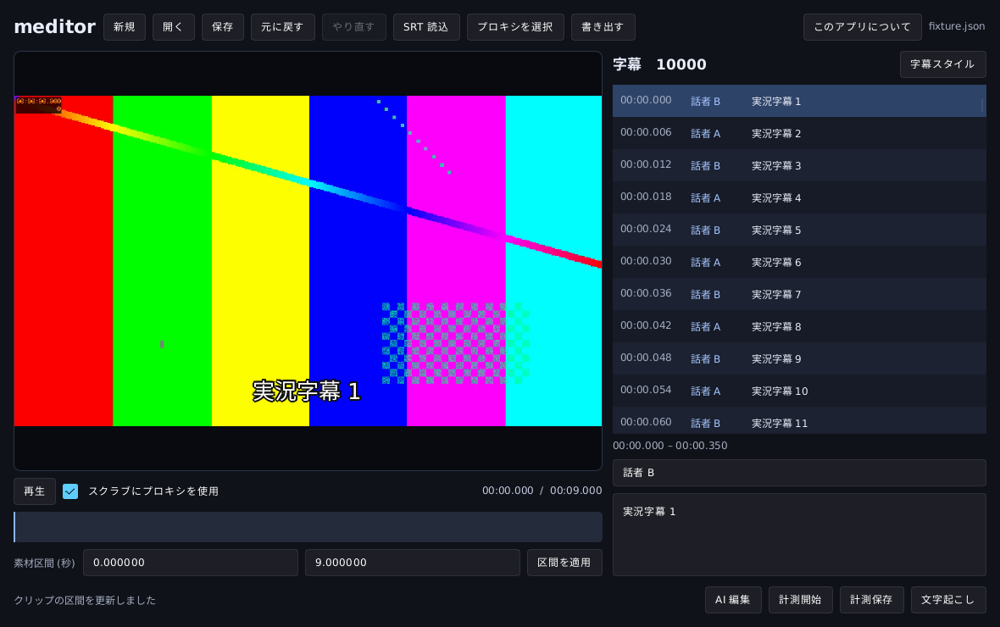
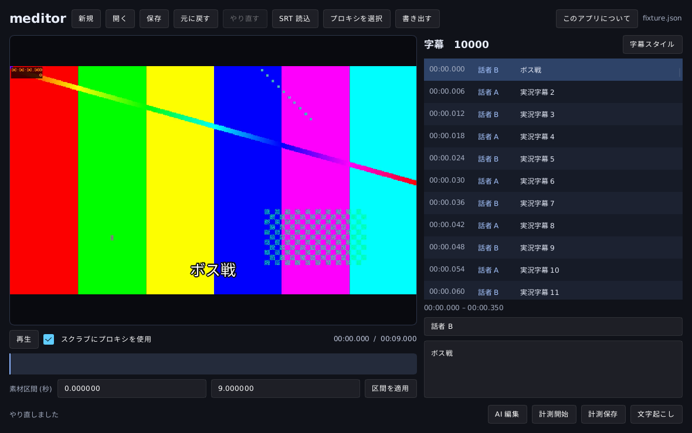

# Undo / Redo の画面検査
[PR #57](https://github.com/keru-labo/meditor/pull/57) · `f45d6e08c42d` · [CIの実行結果](https://github.com/keru-labo/meditor/actions/runs/45402212773)
## シナリオ

- 成功 · Undo の後の新しい編集で通常の Redo の候補を消す
- 成功 · 保存後に開き直したプロジェクトで Undo と Redo を使う

## 成功 · Undo の後の新しい編集で通常の Redo の候補を消す

### 素材区間を0〜9秒に変更する

1. 合成プロジェクトを開く
2. 開始に「0」、終了に「9」を入力して「区間を適用」を押す

| 確認点 | 期待 | 実際 | 結果 |
| --- | --- | --- | --- |
| 素材区間 | 0.000000 – 9.000000 秒 | 0.000000 – 9.000000 秒 | 成功 |

### 区間変更を元に戻す

1. ツールバーの「元に戻す」を押す

| 確認点 | 期待 | 実際 | 結果 |
| --- | --- | --- | --- |
| 素材区間 | 0.000000 – 60.000000 秒 | 0.000000 – 60.000000 秒 | 成功 |
| やり直すボタン | 有効 | 有効 | 成功 |

### 別の編集として字幕本文を変更する

1. 字幕一覧の先頭行を選び、本文を「ボス戦」に書き換える

| 確認点 | 期待 | 実際 | 結果 |
| --- | --- | --- | --- |
| 字幕一覧の本文 | ボス戦 | ボス戦 | 成功 |
| やり直すボタン | 無効 | 無効 | 成功 |

## 成功 · 保存後に開き直したプロジェクトで Undo と Redo を使う

### 字幕と素材区間を順に変更する

1. 合成プロジェクトを開く
2. 字幕一覧の先頭行を選び、本文を「ボス戦」に書き換える
3. 開始に「0」、終了に「9」を入力して「区間を適用」を押す

| 確認点 | 期待 | 実際 | 結果 |
| --- | --- | --- | --- |
| 字幕一覧の本文 | ボス戦 | ボス戦 | 成功 |
| 素材区間 | 0.000000 – 9.000000 秒 | 0.000000 – 9.000000 秒 | 成功 |

### 区間変更だけを元に戻して保存する

1. ツールバーの「元に戻す」を押す
2. ツールバーの「保存」を押す

| 確認点 | 期待 | 実際 | 結果 |
| --- | --- | --- | --- |
| 素材区間 | 0.000000 – 60.000000 秒 | 0.000000 – 60.000000 秒 | 成功 |
| 保存結果 | プロジェクトを保存しました | プロジェクトを保存しました | 成功 |

### 保存したプロジェクトを開き直す

1. 直前に保存した fixture.json を再度開く

| 確認点 | 期待 | 実際 | 結果 |
| --- | --- | --- | --- |
| 字幕一覧の本文 | ボス戦 | ボス戦 | 成功 |
| 素材区間 | 0.000000 – 60.000000 秒 | 0.000000 – 60.000000 秒 | 成功 |
| 元に戻すボタン | 有効 | 有効 | 成功 |
| やり直すボタン | 有効 | 有効 | 成功 |

### 区間変更をやり直す

1. ツールバーの「やり直す」を押す

| 確認点 | 期待 | 実際 | 結果 |
| --- | --- | --- | --- |
| 素材区間 | 0.000000 – 9.000000 秒 | 0.000000 – 9.000000 秒 | 成功 |
